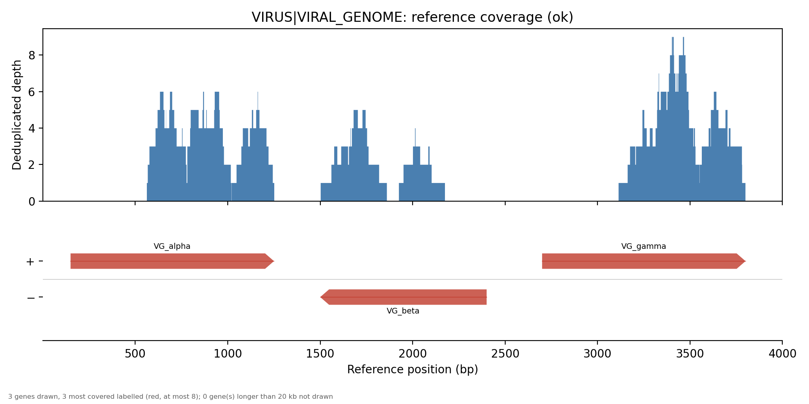

# Read-level evidence

`viralscan evidence` shows the reads behind one candidate call. It runs after a
finished run, writes into `posthoc/`, and never changes a call, a count or a
table of the run. Use it when a call is borderline, when you plan to report it,
or when a virus is known to share sequence with the host. The question it
answers is narrow: do the molecules behind this call align better to the virus
than to the host, and what do those reads look like along the genome?

This page covers what to run, what each output is, and how to read the coverage
map, the browser page and `strand_qc.tsv`. The full column lists are in the
[output reference](output_reference.md#viralscan-evidence-output).

## When to use it

Run `evidence` for one detected virus when any of these holds.

- The call rests on few molecules or few cells.
- The virus has sequence that also occurs in the host (the host-homology
  warning in the [FAQ](faq.md)).
- You want to see where on the genome the reads fall before you report a call.
- You want to know whether the reads carry splice junctions.

Skip it for a first look at a run. Start with `report.html` and
`results/viral_summary_core.tsv` ([Read the results](results.md)).

## What you need

- A finished run (a run root with `run_manifest.json` and `run_complete.json`). A run that is not
  finished is refused.
- The viral genome FASTA (`--viral-fasta`) and the full host genome FASTA
  (`--host-fasta`). `--viral-fasta` requires `--host-fasta`: reads are aligned
  to host and virus together, so a read that fits the host better is not
  counted as viral.
- `minimap2` and `samtools` on `PATH`. `--blast` also needs BLAST+, and
  `--splice` needs minimap2 2.29 or newer (no fallback to an older one).
  Coverage maps need `pyBigWig` ([installation](installation.md)).
- An exact target for `--virus`: an accession, a registered alias or the
  detected virus name. Substring matching is not used.

## Run it

```bash
viralscan evidence \
  --run-dir output/ --sample SAMPLE \
  --virus EBV \
  --viral-fasta EBV.fa --host-fasta GRCh38.fa --host-gtf GRCh38.gtf \
  --blast --splice --html
```

`--run-dir` is the run root (the `-o` directory of `viralscan run`). `--sample`
is needed only when the run has several samples. Output goes to
`output/SAMPLE/posthoc/evidence/EBV/` unless you pass `-o`. A non-empty
directory is reused only when its `evidence_manifest.json` matches the target
and the run fingerprint. Otherwise use a new directory.

`--splice`, `--html`, `--blast`, `--read-start-profile` and `--cell-tags` are
off by default. Each adds outputs and none changes the others.

## The unit: a molecule

Every check counts molecules, not reads. A molecule is one corrected barcode
plus UMI pair. Its member reads are the reads that carry that pair. A molecule
supports a feature when any member read does. The checks on this page use the
molecules that are counted in the run and align better to the virus than to the
host (`counted_virus_best`). Each table also reports how many molecules fell
outside that set. The rule is in `docs/evidence_unit.md` in the repository.

Molecules the kallisto index never captured are outside every evidence run.

## What each output is

| Output | What it holds |
|---|---|
| `read_lineage.tsv.gz` | One row per extracted read: read ID, barcode, UMI, compatible genes, ambiguity class, assigned weight. |
| `molecule_verdicts.tsv.gz`, `molecule_verdict_summary.tsv` | One verdict per molecule: `virus_best`, `host_best`, `tie` or `unaligned`. A verdict compares alignment scores. It is not a probability. |
| `competitive_reads.raw.bam`, `competitive_reads.<mode>_dedup.bam` | Reads aligned to host plus virus together. Open them in IGV with `viralscan_evidence.igv.xml`. |
| `alignment_qc.tsv`, `coverage.*.tsv` | Breadth, depth, identity, mapping quality, duplicates and read-start hotspots per viral reference. |
| `interpretation_flags.tsv` | Host-homology, low-complexity, ambiguity and hotspot flags. They are labels, not filters. |
| `strand_qc.tsv` | Gene-relative strand of the viral reads. See below. |
| `splice/` (with `--splice`) | `splice.bam`, `junctions.tsv`, `splice_summary.tsv`, `splice_manifest.json`. |
| `igv_browser.html` (with `--html`) | One self-contained read browser. See below. |
| `coverage_map.<target>.png/.pdf/.tsv.gz/.json` | The coverage map, from `viralscan evidence-plot --coverage-map`. See below. |

`--splice` realigns the member reads of counted virus-best molecules to the viral
genome alone with `minimap2 -ax splice:sr`. A junction counts molecules, with
reads beside them. A junction supports viral RNA processing. It does not show
where the molecule came from, and it does not show infection or reactivation.
A genome whose GTF has only CDS rows gets `intron_matching_not_evaluable`,
because CDS gaps are never treated as introns.

## Read the coverage map

```bash
viralscan evidence-plot --coverage-map \
  --evidence-dir output/SAMPLE/posthoc/evidence/EBV \
  --target 'VIRUS|<accession>' --annotation viral_genes.gtf
```

`evidence` itself also writes `<reference>_coveragemap.*` figures when
`bamCoverage` and `pyGenomeTracks` are installed. They are a different figure
from the one below.

`--target` is the name of the viral reference inside the evidence BAM.
`--annotation` is a GTF whose sequence name matches the target (the bare
accession also works for viral references). The command reads the two retained
BAMs. It does not replay FASTQs.



*Figure 1. Coverage map of a synthetic example, not a real virus. The genome is
4,000 bp of seeded random sequence with three genes, and the 74 counted
molecules come from 40 cells with real 10x v3 barcodes.*

What the figure shows, top to bottom:

- **Coverage track.** Deduplicated depth in molecules, along the viral genome.
  Raw depth is not drawn. It stays in `coverage_map.<target>.tsv.gz`.
- **Gene lanes.** A `+` lane and a `-` lane of gene boxes. The box head marks
  the 3' end of the gene. Boxes come from exons, else CDS rows, else the gene
  row.
- **Labels.** Only the 8 most covered genes with reads are labelled, in red,
  packed so that no two labels overlap. In Figure 1 all three genes are
  labelled. A label that fits no row is dropped and counted in the JSON.
- **Caption.** The line under the figure counts genes drawn, genes labelled and
  genes longer than 20 kb that were left out. Long spliced transcripts, such as
  EBV latency transcripts, are left out and counted this way.

In Figure 1, depth falls inside the gene boxes and nowhere else. Reads cluster
in the last 600 bases of each gene, because the example reads were generated
that way (3' biased, as in 10x 3' libraries). Real data can be flatter or more
uneven. Look for two things:

- coverage outside every annotated gene (reads in a region with no gene);
- one narrow pile-up with nothing around it (a read-start hotspot; see
  `alignment_qc.tsv`).

`coverage_map.<target>.json` records the status (`ok`, `no_coverage`,
`annotation_missing`, `annotation_mismatch`, `target_not_in_bam` or
`transcript_reference`), the input BAM hashes and the mean deduplicated depth of
every drawn gene.

## Read the browser page

`evidence --html` writes `igv_browser.html`. For an existing evidence directory,
run `viralscan evidence-plot --evidence-dir DIR --html --viral-fasta FA
[--annotation GTF]`. That call writes the page instead of the figures, and it
does not rewrite `evidence_manifest.json`.

The page is one file of about 1 MB for the example (Figure 1's run). It embeds
igv.js 2.15.11 (MIT, shipped in the wheel) and loads nothing from the network.
It shows:

- the viral genome and a gene track from the GTF (one row per transcript; genes
  longer than 20 kb are left out and listed on the page);
- a seeded sample of the member reads of counted virus-best molecules, at most
  4,000 per viral contig, drawn without replacement with a fixed seed;
- the reads of `splice/splice.bam` that carry an accepted junction, when
  `--splice` ran (at most 1,500).

The top of the page states the population, the draw and the sampling rule. A
table gives the size of the population and of the draw for each contig. In the
example the page reported 74 member reads, all 74 drawn, and 0 spliced reads.

The page is for looking. The coverage track is switched off on purpose, because
a sample cannot give a depth. Do not count reads on the page. Counts,
junctions and verdicts come from the TSV tables, which use every molecule. If
the page would pass 25 MB, the draw is halved until it fits and the page says
so. With no counted virus-best molecule, no page is written.

Reads are drawn as aligned to the viral genome. A 10x 3' read lies on the
sense strand of the gene it covers and a 10x 5' read on the antisense strand,
so read strand against gene strand depends on the chemistry.

This release does not ship a screenshot of the page: it needs a browser, and
the file is too large to keep in the documentation.

## Read `strand_qc.tsv`

`strand_qc.tsv` has one row per viral reference and one row `ALL_VIRAL`. Each
read's best viral alignment is cut at gaps into aligned blocks. Each block is
`sense`, `antisense`, `ambiguous_overlap` (genes on both strands) or
`outside_annotation`, judged against the panel GTF. The columns `blocks_*`,
`reads_*` and `molecules_*` count each class.

What counts as expected depends on the library. ViralScan learns it from the
host reads of the same run: blocks of host-best molecules that overlap the exons
of exactly one gene (`--host-gtf` supplies those exons). With at least 200 such
blocks and 80 % agreement, the row fills `expected_orientation` (`sense` for a
3' library, `antisense` for a 5' library) and `fraction_expected_orientation`.
A 10x 5' library therefore is not flagged for antisense viral reads.

The `status` column says whether this worked:

- `assessed`: calibration succeeded and the fraction is filled.
- `not_assessed`, with a `reason`: `host_gtf_missing`, `too_few_host_blocks` and
  `host_orientation_mixed` keep the viral class counts and leave the fraction
  empty. `chemistry_unknown` and `verdicts_not_produced_in_competitor_mode` compute
  nothing.
- `not_evaluable`: no counted virus-best molecule has a viral alignment.

In the example run, the row reads `not_assessed` with `too_few_host_blocks`
(the example has only 40 host reads, so no calibration is possible), and all 74
viral blocks, reads and molecules are `sense`. That fits reads taken from the
sense strand of three genes. It is a consistency check and not a verdict. The
file is written only with competitive alignment (`--viral-fasta` and
`--host-fasta`). It changes no other table, and the default of `--strand` is not
decided by it.

## What this does not claim

- **It is post hoc.** `evidence` reads a finished run and writes under `posthoc/`.
  `detected`, the counts and every table of the run stay as they were.
- **A verdict is a score comparison.** `virus_best` means the best viral
  alignment scored above the best host alignment. It is not a probability, not
  a host-contamination call, and not a diagnosis. Candidate search is limited
  to the alignments the aligner emitted.
- **It does not show origin.** Ambient RNA and integrated genomes (for example
  chromosomally integrated HHV-6) give viral molecules too. A splice junction
  or a read on the browser page supports neither infection nor reactivation by
  itself.
- **No evidence verdict is in this release.** A post hoc verdict that separates
  origin evidence from supporting reads (`EVID-06`), a competitive realignment
  with `splice:sr` against host plus virus (`EVID-07`) and chemistry-specific
  TSO and poly-A trimming (`EVID-08`) wait for a named held-out set and are not
  built. No threshold on this page is calibrated.
- **Competitor mode is partial.** With `--competitor-fasta` there are no
  host-versus-virus verdicts, so `--splice` and `strand_qc.tsv` are
  `not_assessed` and `--html` is refused.

## How Figure 1 was made

The inputs are synthetic and seeded. The script
[`make_example_fixture.py`](_static/evidence/make_example_fixture.py) writes the
genome, the host transcript, 114 read pairs and the cell list. Then:

```bash
python make_example_fixture.py fx

viralscan run -o out --reference --fasta fx/reference.fasta --gtf fx/combined.gtf \
  --r1 fx/R1.fastq --r2 fx/R2.fastq -x 10xv3 --strand unstranded --tchem off -c 2 \
  --no-visual --cell-calling external --called-cells-file fx/called_cells.txt \
  --infected-min-molecules 1 --yes

viralscan evidence --run-dir out -o evidence --virus VIRAL_GENOME \
  --viral-fasta fx/viral.fasta --host-fasta fx/host.fasta --host-gtf fx/host.gtf \
  --splice --html --dedup umi --sampling-seed 42 -c 2

viralscan evidence-plot --coverage-map --evidence-dir evidence \
  --target 'VIRUS|VIRAL_GENOME' --annotation fx/combined.gtf
```

The run used `--infected-min-molecules 1` because each example cell holds one to
three molecules. The PNG is `evidence/coverage_map.VIRUS|VIRAL_GENOME.png`,
copied unchanged to `docs/_static/evidence/coverage_map_synthetic.png`.
The checkout was commit `70742f44` with minimap2 2.31 and samtools from the
`viralscan_test_full` environment.
